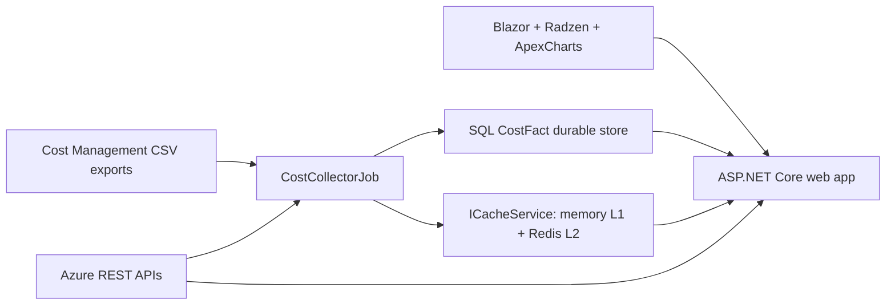

# CmCSP - Azure CSP Cost Dashboard

CmCSP is a .NET 10 Blazor Web App using **Interactive Server rendering,
Radzen.Blazor, and Blazor-ApexCharts**. It reports Azure cost, reservations,
optimization opportunities, security posture, and carbon emissions across subscriptions.
Browser sign-in uses Microsoft Entra ID; the read-only REST API uses a separate API key.

## Projects

| Project | Responsibility |
|---|---|
| [CmCSP](src/CmCSP.csproj) | Blazor UI, authentication, public REST API, collection controls |
| [CmCSP.Core](src/CmCSP.Core/CmCSP.Core.csproj) | Models, EF Core context, Azure clients, collection and cache services |
| [CostCollectorJob](src/CostCollectorJob/CostCollectorJob.csproj) | Scheduled and on-demand cost collection |
| [CostBackfillJob](src/CostBackfillJob/CostBackfillJob.csproj) | Explicitly invoked historical export import into SQL |

All four projects target `net10.0`. Direct NuGet dependencies have explicit stable
versions; Microsoft ASP.NET Core, EF Core, and Extensions packages stay on the
.NET 10 servicing line. UI dependencies are Radzen.Blazor 13.1.0 and
Blazor-ApexCharts 8.0.0. Review the applicable package licenses before distribution.

## Architecture



Blob exports are the source feed, SQL is the optional durable store, and the cache
is a disposable serving layer. With the data platform disabled, the app reads
exports directly and can use the legacy Table/Blob shared cache. Direct API mode
and enrichment calls use Azure REST APIs. Cross-tenant customer collection uses
per-tenant service-principal tokens; managed identity alone cannot cross tenants.
Trend, budget, month-over-month, and subscription summaries use daily
subscription-level aggregates; dimension-heavy views retain their detailed rows.

## UI

Radzen provides the responsive layout, navigation, cards, forms, alerts, and data
grids. ApexCharts renders the charts. Shared date and subscription filters update
every analytics page; chart keys force recreation when the filter version changes.
Light/dark mode is persisted in browser local storage and applied to Radzen and
ApexCharts. driver.js provides page-specific guided tours.

| Route | View |
|---|---|
| `/` | Cost overview, anomalies, subscription/export management, collection status |
| `/budgets` | Subscription budgets and spend |
| `/subscriptions` | Subscription costs, amortization, reservation savings |
| `/resource-groups` | Resource group cost allocation |
| `/tags` | Tag chargeback and live inventory tag coverage |
| `/trend` | Actual/amortized trends and forecasts |
| `/waterfall` | Month-over-month cost movement |
| `/advisor` | Advisor cost recommendations |
| `/reservations` | Reservation utilization, recommendations, expiry |
| `/marketplace` | Azure versus Marketplace spend |
| `/optimization` | Inventory and orphaned/idle resources |
| `/security` | Defender for Cloud secure scores and findings |
| `/sustainability` | Azure carbon emissions |
| `/customers` | Feature-gated partner customer administration |
| `/public-api` | API usage information |

## Local development

Install the .NET 10 SDK. Azure operations additionally require Azure CLI,
Azure Developer CLI, PowerShell 7, and access to the configured resources.

```powershell
dotnet restore CmCSP.slnx
dotnet user-secrets set "AzureCostManagement:TenantId" "<tenant-id>" --project src\CmCSP.csproj
dotnet user-secrets set "AzureCostManagement:ClientId" "<client-id>" --project src\CmCSP.csproj
dotnet user-secrets set "AzureCostManagement:ClientSecret" "<client-secret>" --project src\CmCSP.csproj
dotnet user-secrets set "AzureCostManagement:SubscriptionIds:0" "<subscription-id>" --project src\CmCSP.csproj
dotnet run --project src\CmCSP.csproj
```

Register the application's local and deployed `/signin-oidc` redirect URIs as
**Web** redirect URIs in Entra. The application uses authorization-code flow.
Do not put credentials in source control or include them in logs.

## Configuration

Defaults are in [appsettings.json](src/appsettings.json); option types are in
[CostManagementOptions.cs](src/CmCSP.Core/Models/CostManagementOptions.cs).
Environment variables use `__` in place of `:`. Deployed identity settings are
wired by the provisioning hook; the client secret is a Key Vault reference.

| Setting | Purpose |
|---|---|
| `AzureCostManagement:TenantId/ClientId/ClientSecret` | Entra sign-in and service-principal Azure access |
| `AzureCostManagement:SubscriptionIds` | Home subscription registry, augmented by runtime additions |
| `AzureCostManagement:TargetCurrency/ExchangeRates` | Cost normalization |
| `AzureCostManagement:ExportBlob` | Export source location and enablement |
| `ConnectionStrings:Sql` | Optional SQL store; Entra authentication, not a SQL password |
| `AzureCostManagement:Redis` | Managed Redis L2, managed-identity authentication |
| `AzureCostManagement:AzureCache` | Optional legacy Table/Blob L2 |
| `AzureCostManagement:CostDetails/BillingAccount` | Reservation detail and billing scopes |
| `AzureCostManagement:MultiTenancy` | Gated customer isolation and home tenant |
| `CollectorJob` | Job coordinates and manual collection partition count |
| `PublicApi:ApiKey/HeaderName` | API access credential and header name; override securely |

## Validation

```powershell
dotnet build CmCSP.slnx --configuration Release
dotnet list CmCSP.slnx package --outdated
dotnet list CmCSP.slnx package --vulnerable --include-transitive
```

The solution currently contains no automated test project. For UI changes, also
check authenticated routes, forms, grid sorting/paging, both themes, responsive
navigation, date/subscription filters, charts, and tours in a browser. Public
endpoints `/openapi/v1.json` and `/api-docs` do not require browser sign-in;
data endpoints under `/api/v1` require the configured API key.

## Deployment and operations

```powershell
azd env list
azd deploy --environment <existing-environment> --no-prompt
```

`azd deploy` builds and deploys the web app and runs a postdeploy hook that builds,
pushes, and updates the collector image. It does **not** provision infrastructure
or execute collection/backfill. The backfill executable is an operator-invoked
utility, not an automatically provisioned Azure job.

For a new environment, follow the [azd deployment guide](docs/azd-deployment-guide.md)
and [CSP setup guide](docs/csp-deployment-guide.md). Configuration/infra changes
use `azd provision`; provisioning can incur costs and should be followed by deployment.

## Documentation

- [Azure roles](docs/azure-roles.md)
- [Data collection operations](docs/data-collection.md)
- [SQL and Redis](docs/phase4-data-platform.md)
- [Cost Details and reservations](docs/cost-details-api.md)
- [Multi-tenancy](docs/phase9-multitenancy.md)
- [Current capability index](docs/todo.md)
- [Copilot customizations](docs/copilot-agents.md)

The numbered documents under [docs/phases](docs/phases) describe the corresponding
current subsystems rather than historical delivery checklists.
